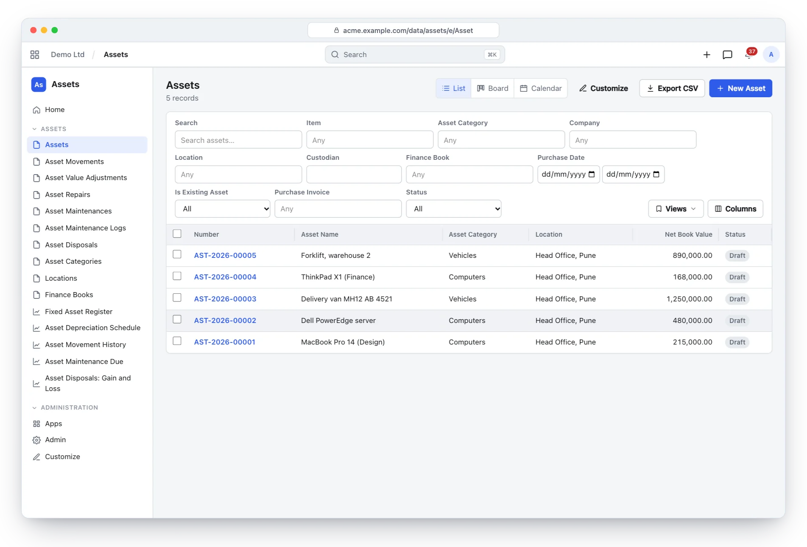
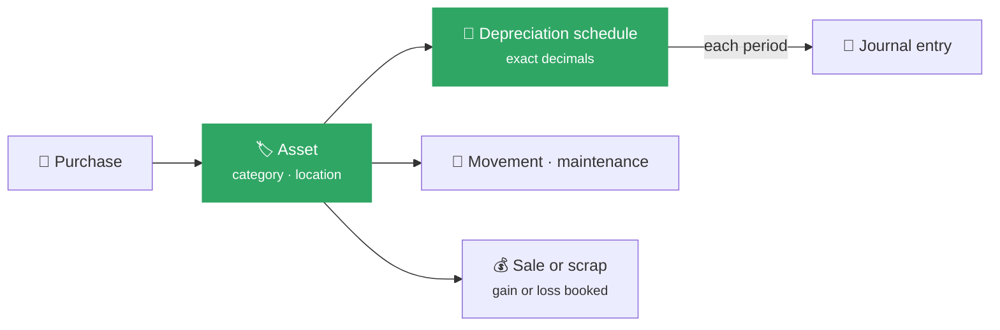
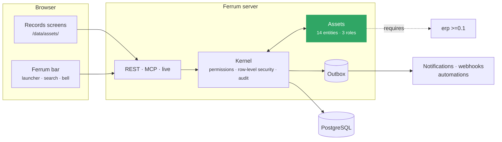
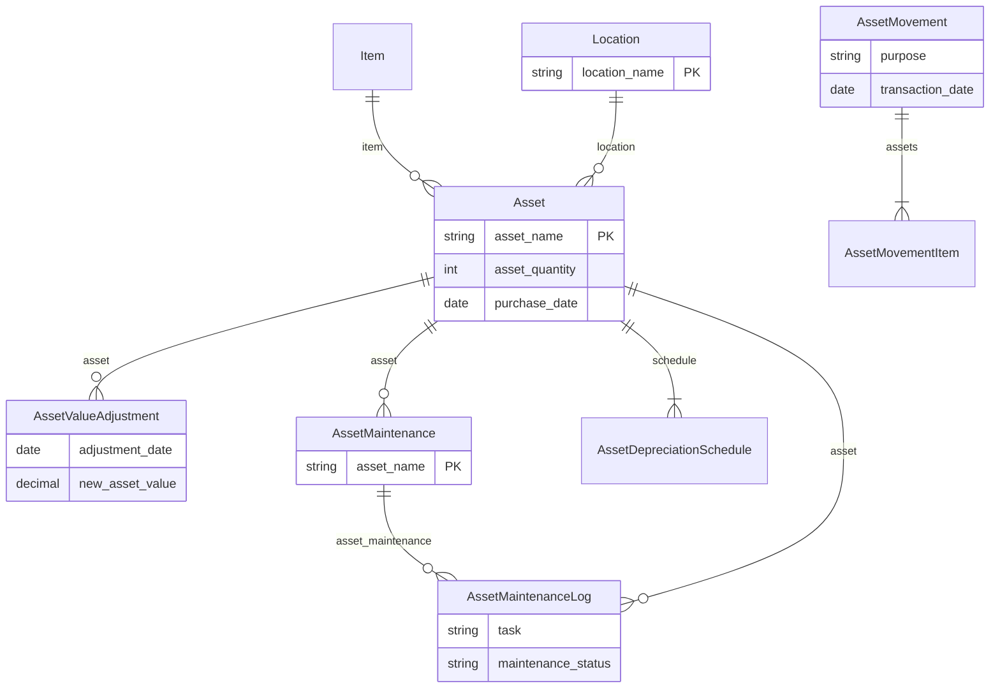

<div align="center">

<picture>
  <source media="(prefers-color-scheme: dark)" srcset="docs/assets/banner-dark.svg">
  
</picture>

[](https://github.com/CBFerrum/ferrum-app-assets/actions/workflows/ci.yml)     

**A native app for [Ferrum](https://github.com/CBFerrum/Ferrum), the open-source, AI-first business platform.**

[Overview](#overview) · [Highlights](#highlights) · [Screenshots](#screenshots) · [How it works](#how-it-works) · [Data model](#data-model) · [Install](#install) · [Develop](#develop) · [Changelog](#changelog)

</div>

---

## Overview

Ferrum Assets keeps the fixed asset register: categories with depreciation defaults and
accounts per company; assets with location, custodian and cost center; depreciation schedules
generated with exact decimal maths and posted automatically as journal entries; and movements,
maintenance, revaluation and disposal, each booked in the ledger.


| At a glance | |
|---|---|
| 📦 Version | `0.1.1` |
| 🧱 Platform | Ferrum `>=0.3.1, <0.4` |
| 🔗 Requires | erp `>=0.1` |
| 🖥️ Interface | Ferrum's records screens (`/data/assets/`) |
| 🗃️ Records | 14 entities in 1 package |
| 👥 Roles | 3: Asset Manager, Asset User, Accounts Manager |
| 📊 Reports | 5 |
| 🧪 Tests | 13 Rust tests |


## Highlights

<table>
<tr>
<td width="50%" valign="top">

### 🏷️ Categories
Straight line, written down value, double declining or manual; accounts per company.

</td>
<td width="50%" valign="top">

### 🏢 Assets
Location, custodian, cost center, finance book; existing assets with opening depreciation.

</td>
</tr>
<tr>
<td width="50%" valign="top">

### 🧮 Exact schedules
Pro rata first periods, rounding absorbed by the last row, never below salvage.

</td>
<td width="50%" valign="top">

### 📒 Automatic posting
Due depreciation booked as journal entries, idempotent and resumable.

</td>
</tr>
<tr>
<td width="50%" valign="top">

### 🔧 Movements and maintenance
Transfers, maintenance logs, revaluation and disposal with gain or loss.

</td>
<td width="50%" valign="top">

### 📊 Reports
Register, depreciation schedules and movement history.

</td>
</tr>
</table>

## Screenshots

<picture>
  <source media="(prefers-color-scheme: dark)" srcset="docs/assets/assets-dark.webp">
  
</picture>

<p align="center"><sub>The asset register: categories, locations and book values.</sub></p>

> [!TIP]
> The screenshots follow your GitHub theme: switch between light and dark to see both.

## How it works

### An asset's life



### Inside Ferrum



Everything Assets adds is ordinary Ferrum metadata and Rust: its records get lists, forms,
search, permissions, an audit trail, exports and the REST and MCP APIs for free, so AI agents work
with them under the same rules as people.

## Data model

The main records and how they connect (14 entities in all; `packages/` has every field).



### Roles

| Role | What it is for | Entities |
|---|---|---|
| **Asset Manager** | Registers, depreciates, moves, revalues, repairs, maintains and disposes of assets. | 24 |
| **Asset User** | Looks after the assets in their custody - sees them, records their repairs and maintenance work. | 10 |
| **Accounts Manager** |  | 10 |

<details>
<summary><b>Reports (5)</b></summary>

- Fixed Asset Register
- Asset Depreciation Schedule
- Asset Movement History
- Asset Maintenance Due
- Asset Disposal Gain Loss

</details>

## Install

Workspace administrators install it from **Apps** (`/store/`) in Ferrum; it ships in the
official Ferrum server image. It needs **erp** `>=0.1` installed first. Self-hosters building their own image enable the
`assets` feature of the server. Everything it adds is also available to AI agents over
Ferrum's MCP server, within each person's permissions.

## Develop

Clone it next to the platform:

```text
work/
├── ferrum/            https://github.com/CBFerrum/Ferrum
└── ferrum-app-assets/
```

Point the platform dependencies at your checkout (this file is git-ignored):

```toml
# .cargo/config.toml
[patch."https://github.com/CBFerrum/Ferrum"]
ferrum-calc = { path = "../ferrum/crates/calc" }
ferrum-domain = { path = "../ferrum/crates/domain" }
ferrum-kernel = { path = "../ferrum/crates/kernel" }
ferrum-meta = { path = "../ferrum/crates/meta" }
```

The tests need PostgreSQL with an ordinary (non-superuser) role, so row-level security
applies:

```bash
createuser ferrum --pwprompt && createdb -O ferrum ferrum_assets_test
cargo test
```

`FERRUM_ASSETS_TEST_DATABASE_URL` overrides the database URL.


### Project layout

```text
app.yaml      the manifest: id, version, requirements, what it adds to Ferrum
packages/     metadata: entities, roles, reports, workflows, print formats
src/          the app's logic in Rust: hooks, actions, endpoints, upkeep jobs
tests/        integration tests against a real PostgreSQL
CHANGELOG.md  what changed in each version
```

## Changelog

| Version | Highlights |
|---|---|
| **0.1.1** | Requires the ERP app : installing it in a workspace without ERP installs ERP whole, with its interface, rather than a few of its packages. |
| **0.1.0** | First release: asset categories with per-company accounts, locations, assets with generated or manual depreciation schedules (straight line, … |

Every version is in [CHANGELOG.md](CHANGELOG.md).

## License

[AGPL-3.0-only](LICENSE), like the platform. Part of [Ferrum](https://github.com/CBFerrum/Ferrum) ·
[Report an issue](https://github.com/CBFerrum/ferrum-app-assets/issues)
